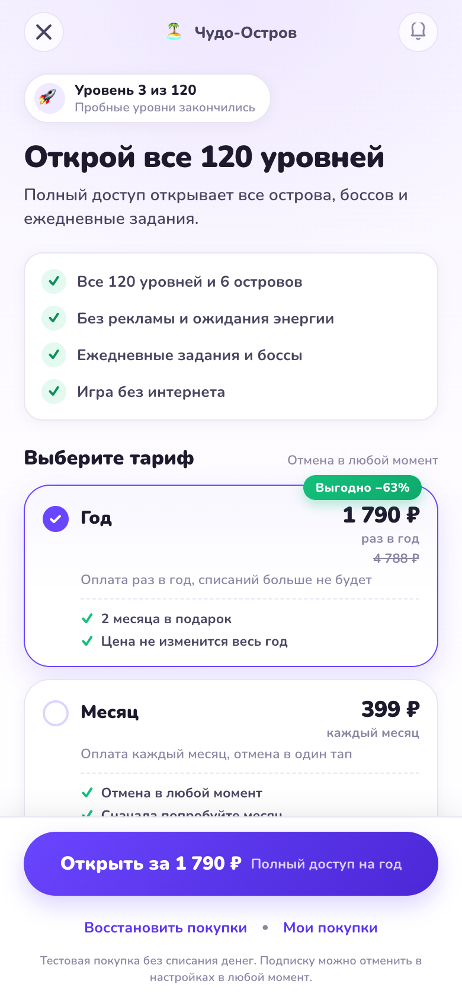
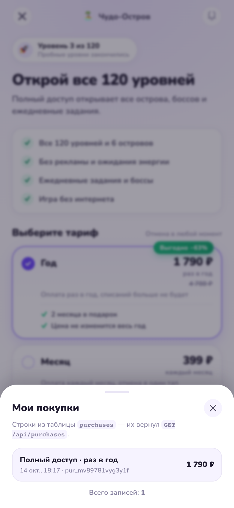
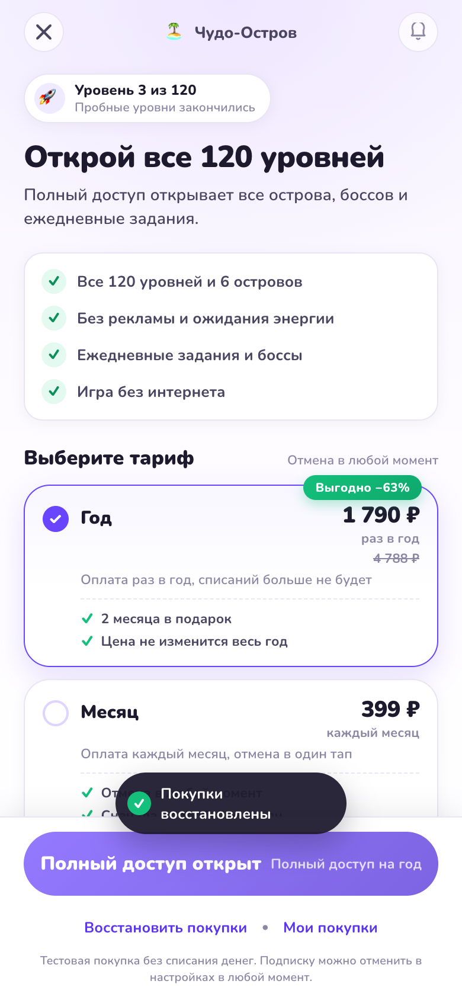
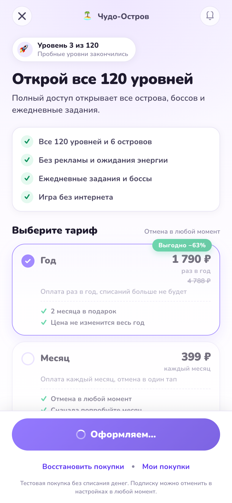
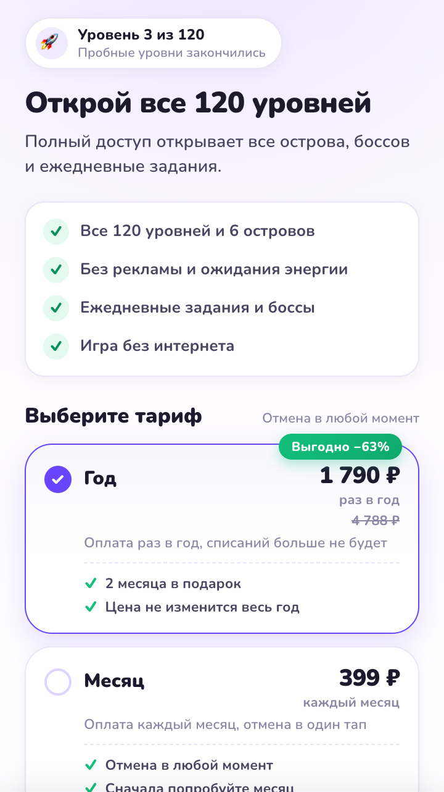
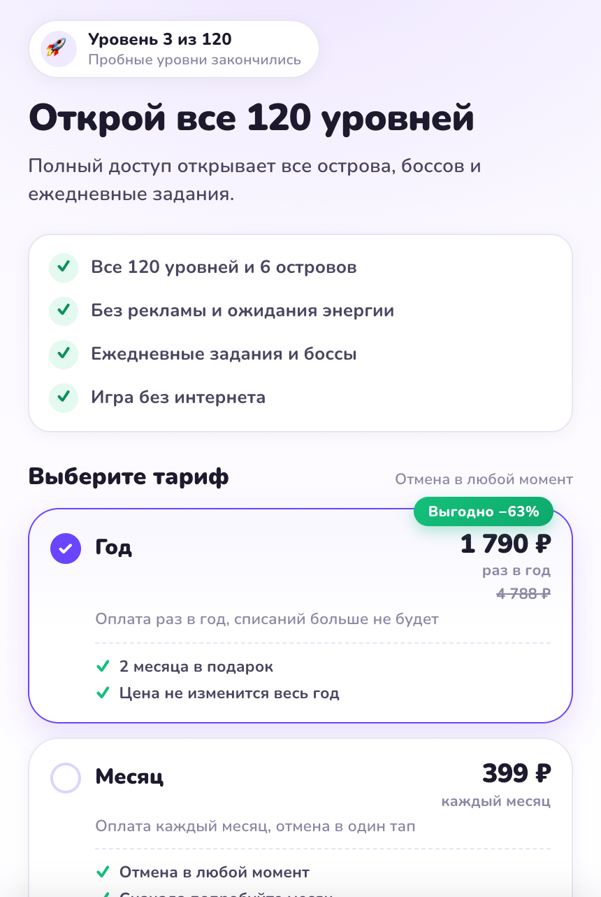

# Дизайн-макет paywall — визуальная спецификация

Этот документ — визуальный макет экрана: скриншоты сняты с **реализованного и
задеплоенного** приложения в реальном Chrome (DPR 2), поэтому показывают ровно то,
что видит пользователь в webview.

- Эталонный фрейм: **390 × 844**
- Цвета, отступы, шрифты и тап-зоны: [`DESIGN.md`](./DESIGN.md)
- Точные координаты и размеры блоков: [`../design/screenshots/metrics.json`](../design/screenshots/metrics.json)

---

## 1. Основной экран (390 × 844)

Тариф «Год» выбран по умолчанию, заметное состояние — фиолетовая рамка,
залитая радиокнопка и мягкая тень.



## 2. Состояние загрузки тарифов

Skeleton-карточки с shimmer; CTA заблокирована, пока тарифы не пришли.


## 3. Состояние ошибки загрузки

Понятный баннер с причиной и кнопкой «Повторить», CTA заблокирована.


## 4. Успешная покупка

Подтверждение доступа, кнопка «Продолжить игру» и чек: тариф, сумма, дата,
номер покупки.


## 5. «Мои покупки» — история с данными из БД

Лист открывается по компактной ссылке в CTA; строки читаются из базы
(`GET /api/purchases`).



## 6. Восстановление покупок

Отдельный сценарий: тост подтверждает, что доступ найден либо уже активен.



## 7. Процесс покупки

CTA переходит в состояние загрузки со спиннером, карточки приглушаются,
повторный тап заблокирован.



---

## Адаптивность: 360 / 375 / 390 / 430 px

Экран mobile-first, проверен на четырёх ширинах — переносов заголовка,
горизонтального скролла и «прыгающих» карточек нет.

| 360 px | 430 px |
| --- | --- |
|  |  |

Измеренные размеры карточек на всех ширинах совпадают до сотых:
`154.02 px` (выбранная) и `137.02 px` (обычная), ширина — по контейнеру.

## Соответствие реализации макету

| Ширина | Расхождение с эталонными метриками |
| --- | --- |
| 360 px | 0.00 px по всем блокам |
| 390 px | 0.00 px по всем блокам |
| 430 px | 0.00 px по всем блокам |

Проверка выполняется скриптом:

```bash
pnpm shots                                        # локальные метрики
node scripts/check-deploy.mjs https://<домен>     # метрики живого деплоя
```
